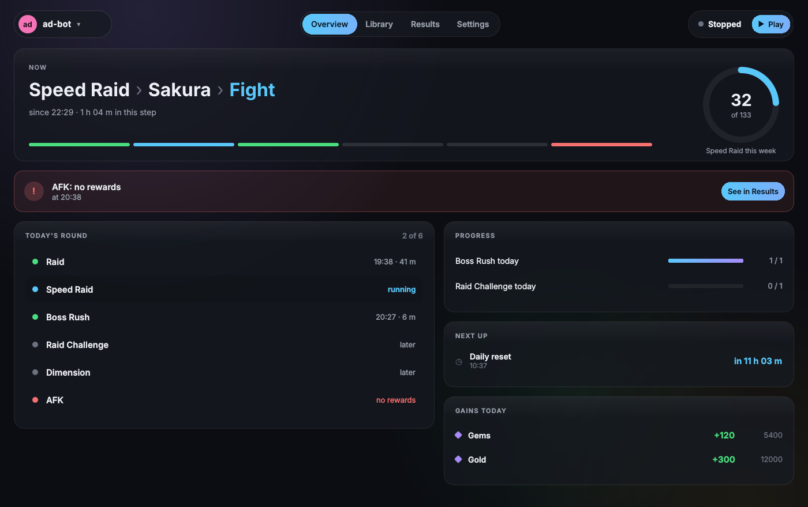
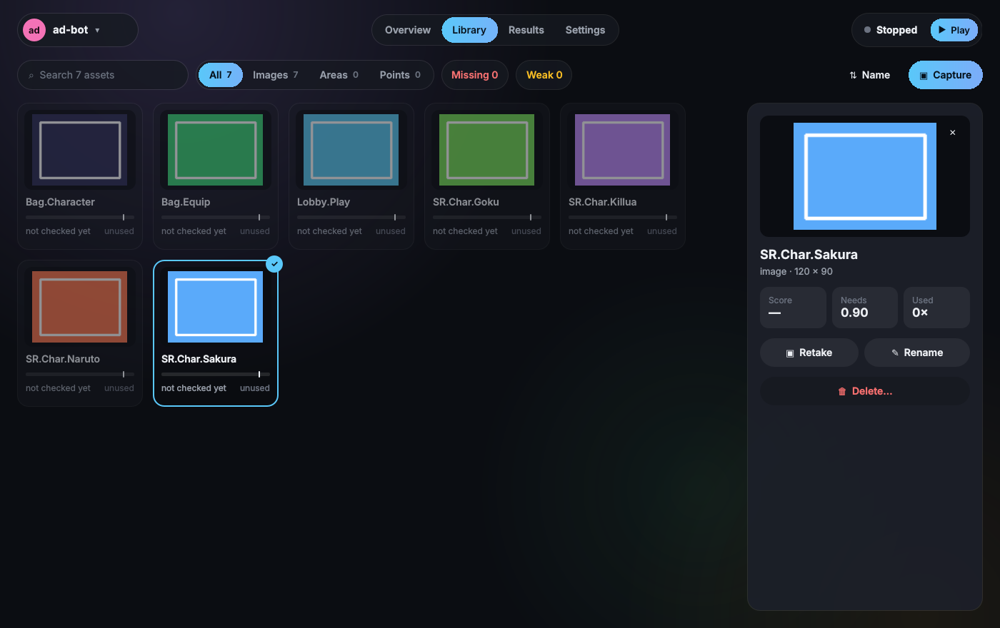
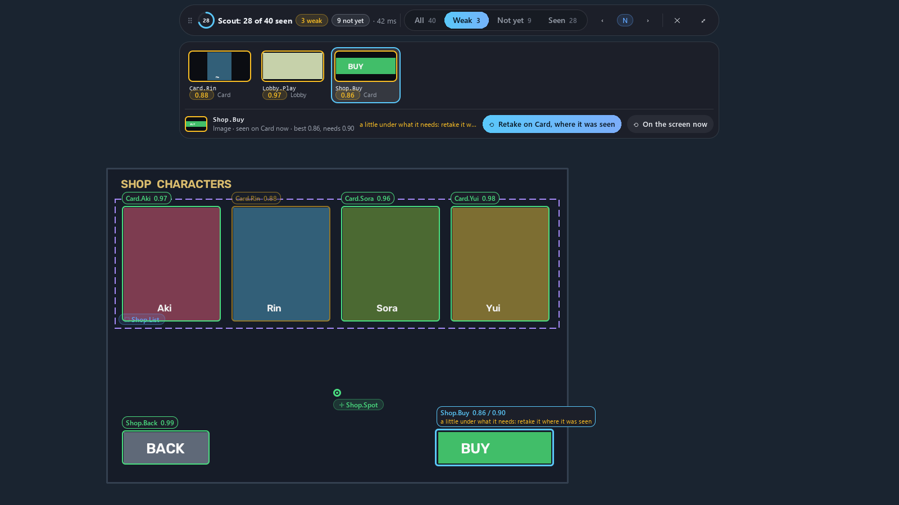
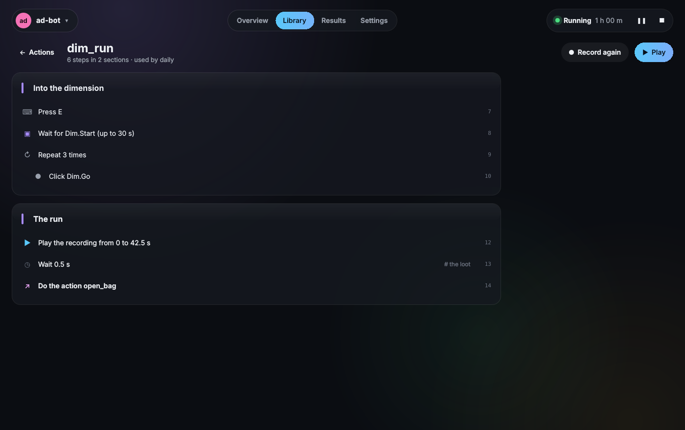

# darbit Studio

darbit Studio is a window onto darbit's service: pick a bot, run, pause and stop it, and see what it's doing. It's built with Qt (PySide6 and QML) and needs the `studio` extra:

```bash
pip install "darbit[studio]"     # or, in a checkout: uv sync --extra studio
darbit app
darbit app --shortcut            # once: darbit Studio in the Start menu and on the desktop
```

The shortcut opens the Studio with the Python it was made from, without a console window. The Studio has darbit's icon in the taskbar, its own button rather than Python's.



When the last two failures or more all came down to the same image, it may have stopped matching (a game update): the
Overview says so with Retake, and a Windows notification from the tray says it once, also while the Studio is out of
sight. A phone gets it too when `notify.toml` has a channel.

- **Bots:** the bot menu at the top left lists every bot, with **New bot** (from darbit's template, from a git link, or a
  folder you have) and **darbit settings**. darbit settings can put the bots in a sidebar instead, which folds to their
  squares on a narrow window. The Studio opens on the bot shown last.
- **Overview** (Ctrl+1): a line for anything that needs you (a locked screen, setup images not taken yet, an image
  that may have stopped matching, with Retake, the last problem), then the bot's blocks in rows: what it's doing now,
  its round, rings for its progress, numbers and week charts for its gains, what's next, its last screen,
  **Recoveries** (how often it got itself going again today with `d.record.recovered`, the most common reason and the
  last one), blocks of the bot's own and buttons for its actions. The bot's author lays out the default
  (`overview.toml`); **Customize** lets you drag blocks around, drag a corner to make one wider or narrower, take one
  off (✕) and add any from the gallery. Your layout is kept for that bot; ↺ goes back to the bot's.
- **Library** (Ctrl+2): the bot's actions first, then every image, region and location, with an image's last score
  against the similarity it needs. Search (Ctrl+F), filter by kind (Images, Regions, Locations, Actions; a region is a place of its own, which images name), Missing or
  Weak, sort by name, weakest or most used, and group by name or kind if you like. Click one for the inspector: its
  numbers and last scores (an image also says its region and location, the defaults included: the whole screen and
  its centre), **Retake**, **Rename** (every line of code naming it changes too, and its box on the screens kept for the Screen view), **Delete**, **Scout on screen**
  for an image, and where it's used; an action has **Play**, **Open**, **Record again** and **Rename**. After a
  Delete or a Rename, **Undo** in the message at the bottom takes it back (only the last delete is kept, in the bot's
  `.darbit/deleted`). A name too long for its card shows whole on hover.

  **Screen** in place of **Grid** shows each screen's last shot from Capture with the targets taken on that shot in
  place (a new shot of a screen starts it over); click one for the side panel, where **Retake on this shot** opens
  Capture on that shot instead of the screen now.

  
- **Kinds of target.** Each target's settings file names its kind: an **image** (searched in its region, the whole
  screen without one, and clicked at its location, its centre unless moved), a **region**, or a **location**.
  Capture writes it; `darbit kinds BOT` writes it into files from before.
- **Capture** (the Library's Capture button, or Ctrl+Alt+C with the game in front): the Studio steps aside, the screen
  is frozen, and it opens full screen. A target is an image, the region it's searched in and the location to click,
  made together. Pick what you're making in the pill (**Image**, **Region**, **Location**, or **1**, **2**, **3**,
  **Tab**): a click boxes the image or region around it (again for bigger, right-click for smaller), a drag draws
  one, and with Location a click sets it. What's picked is what the arrow keys (a press is 1 px, Shift: 10 px, Ctrl: its
  size; held for half a second, they speed up), drag-to-move and **Delete** change; drag its edges or corners to resize it, like cropping; a ✓ marks each kind the target has. With Region picked, an image is searched on the **Whole screen**, in a **Shared** region (pick one, pointing at
  it shows it on the screen, or share the region just drawn under a name of its own; every image in it moves with it)
  or in **Its own** region. A save closes Capture when nothing is left to take. Click a readout to type exact
  numbers; **Ctrl+Z** and **Ctrl+Y** undo and redo. The pill slides out of sight a few seconds after the mouse leaves
  it: move the mouse to its edge to bring it back. Like every pill it can be moved (see **Moving a pill**). A retake keeps the target's region and location; hold **C** to
  see the saved image over the new one. A magnifier follows the mouse with the shot's own pixels (8×; Ctrl+wheel from
  2× to 24×), the target's parts and the place and colour of the pixel under it; **Z** pins it. **T** tests the image
  in its region: a line sweeps it, then it says whether the image was found once, more than once or not at all, and
  how many look-alikes score under the line, with each match's score and a slider for the similarity it needs.
  **Enter** saves; **Esc** removes what's picked, then closes. From the name, **Tab** and **Shift+Tab** go through the
  pill's buttons, **Enter** or **Space** presses one and **Esc** goes back to the shot. With a setup guide, the next one
  to take is shown.
  A retake can also open on a saved screenshot (a failure's on Results, a screen's last shot in the Library): the
  image is cut from it at its own pixels, and Capture says so; saved shots are JPEG, so it's a little softer than one
  from the screen now.

  Taking new targets (the Library's Capture or Ctrl+Alt+C), several can be taken on the same shot: a box made away
  from the active target, of its own kind, starts another one (**A** starts one too, for a Region or Location on its
  own). Each starts with a name made from the time it was taken (as SikuliX does), so a batch can be saved and renamed
  later. Click a box to make it the active one: it's highlighted, its name field sits beside it, and the kind, the
  handles and the arrows act on it; **N** and **Shift+N** step through them. The name of the box under the mouse
  shows on it. **T** tests every image on the shot at once, each with its score and look-alikes on its box; **Enter**
  saves them all, and **Ctrl+Z** undoes each change, a box removed included. The pill lists them: the stack (how
  many are on this shot) opens into tiles, each with its image, name, kind and Test's score; on the top or bottom
  edge they're a row under the pill's buttons that scrolls sideways, on a side or floating two columns that scroll up
  and down. Click a tile to make its target the active one, ✕ to drop it. A retake (from the Library, Results,
  the start check) and the setup guide take one target, as before.
- **Run pill** (darbit settings, on by default): the bot starting (Play, the tray, the command line or the service) hides the Studio, and a pill at the top of the screen shows the
  bot, where it is and for how long, with Pause, Stop and ⤢ to open the Studio. A few seconds after the mouse leaves
  it, it slides out of sight past its edge; move the mouse to that edge beside it to bring it back (the bot's own moves
  don't). Floating, it shows where the bot is, today's round so far and the last step that ended. Every other bot
  running or paused gets a line of its own under it (in a column, a block of its own), with its state, its time and
  its own Pause and Stop; one with `[run] input = false` says **alongside**. The
  bot never sees it in its screenshots. Closing the Studio to the tray or minimizing it while a bot is running or
  paused opens the pill too, with that bot. The Studio comes back when the bot stops or fails, or from the tray, and
  showing it closes the pill.
- **Moving a pill:** every pill over the game (the run pill, Capture's, Scout's and the recorder's) starts at the
  top centre and can be dragged by its grip (⠿) or any empty part of it. On the top and bottom edges it's a row, on the
  left and right a column with its buttons labelled; it stays where it's let go along its edge, and lands on an edge's
  centre or a corner only when let go very close to one. Pills stay above the taskbar, on whichever side it is (one
  that hides itself too). While it's dragged it tilts and sways a little, eases into the shape it will have, and the
  nearest edge lights up with a circle at its corners and centre and a filled one following the mouse to where it
  lands. Dragged past the dashed line into the middle, it floats: a small card with more detail, always shown, exactly
  where it's let go, with **Dock** to put it back on its edge (dragging it to an edge docks it too). Each pill keeps its place for next time. With several screens it can go on any of them, but not on an edge one
  screen shares with another, where it couldn't hide.
- **Ghost cursor** (darbit settings, on by default): a ripple where a running bot clicks and keycaps for the keys it
  presses, over the game, for a moment each. Clicks go through it, and it shows only while there's something to show.
- **Scout** (Ctrl+Alt+S with the game in front, the tray panel or the command palette, or Scout on screen in the
  Library's side panel to land on one image): a check of the whole library while the game's menus are gone through by
  hand. The Studio steps aside and every image of the bot is searched a couple of times a second; each one found gets
  its box and score over the game, one just under what it needs a faint one. Images found on the same spot are marked
  ⚠ with the others' names: the bot can't tell them apart there, which the `colour` option often fixes. Clicks go to
  the game. Scout keeps a record for the session: each image is **seen** (when, its best score, on which screen),
  **weak** (found under what it needs, or with a look-alike) or **not seen yet**, and the latest shot of each screen
  it saw is kept (one per screen, in the bot's `.darbit/scout`) for a retake on it. The Regions and Locations of the
  screens showing are drawn on them in their kinds' colours. Its pill says "Scout: 31 of 40 seen", in three forms:
  - **Docked on the top or bottom:** a group filter (All, Weak, Not yet, Seen) and a strip of the group's images that
    scrolls sideways. **N** and **Shift+N** (or ‹ ›) step through it, with the game in front; the one landed on is
    boxed on the game in the accent, with its region dashed and what's wrong, and a line under the strip says where and
    how well it was seen, with its retakes: **on the shot where it was seen** (Capture on that saved shot) and **on the
    screen now**. One never seen has only now. While Scout is on, N and Shift+N go to Scout, not the game (change them
    in darbit settings).
  - **Docked on a side:** a ring with how many are seen, then the groups (Not seen yet, Weak, Seen), each folding, in a
    list that scrolls; a line hovered shows its retakes.
  - **Floating:** every image in a grid, coloured by its state; one clicked opens in full: the image large beside the
    saved shot where it was seen with its box, its best score against what it needs, why it's weak and its retakes;
    ‹ › step on, **Every image** goes back to the grid.

  ✕ hides Scout, ⤢ goes back to the Studio, **Reset the session** starts the record over. A retake hides Scout while
  Capture is open and brings it back after, with that image's record started over. The record stays while Scout is
  hidden. Its key again hides it too; a key set for Highlight before (`highlight.toggle`) still works.

  
- **Record** (the Library's Record button): name the action, and the Studio steps aside. A pill on the screen's edge
  shows the time and the steps caught; every key, click, wheel notch and mouse move goes in, on one clock, until
  **Done**. **Pause** (Ctrl+Alt+P) to add a check: wait for an image or until it's gone (Capture opens on that
  moment to take it), or a wait. ⚑ (Ctrl+Alt+K) is a checkpoint: what came before becomes its own action. ≡ shows the
  steps; ✕ throws the recording away. Clicks on the pill aren't recorded.
- **Actions** (the Library's Actions): each with its steps and what calls it; **Play**, **Open**, **Record again**,
  **Rename** (every call changes too) and **Delete**. In an action's editor, click the dot beside a step to stop Play there; **Step through**
  stops at the first line, and while it's stopped, **Next line** runs one line and **Go on** plays on.
- **An action, open** (Open, or double-click its card): its sections as cards and its steps read like what they do:
  keys, waits, images to wait for, clicks, loops and ifs with their steps indented, the recording's span, calls to
  other actions. **Play** walks through them, the step playing glowing. A section's name, a wait's seconds (hover it)
  and the order of steps (↑ ↓) can be changed and steps removed (✕); the save bar writes the action's file
  (Ctrl+S). It's still plain Python in `actions/`, so it opens in any editor too.

  
- **Results** (Ctrl+3): the bot's days; the chosen one in a sentence, its problems, what it got (today, the week, the
  total) and a timeline of its modes, from the run history. **Problems** are explained: each kind is grouped by its
  likely cause (something covered the game, an image looks different now, an image wasn't on screen, or the bot's own
  reason) with a sentence of what the bot saw; opened, it shows the screen when it stopped with the closest match of
  the image it waited for boxed and scored, beside the images that ran out before it stopped (best against what each
  needs, for how long) and the steps before it. Under the screen, **Retake** takes the image again on that screen (the
  moment it failed) or on the screen now; Scout, the screenshots and Not a problem are beside the steps.
- **Settings** (Ctrl+4): the bot's `settings.toml`, one row per setting with a control made for its type: a switch, a
  stepper (a number with − and +, kept in its range), a slider for a number with a min and a max, a list, or a field.
  The section cards flow into two columns on a wide window; the section list has search (Ctrl+F), counts, and a dot on
  sections with changes. A changed value gets a dot, ↺ puts it back to its default, and a save bar slides up (Ctrl+S
  saves). On a wide window a panel explains the setting under the mouse: what it does, its value, default, range and
  key.
- **The run control** (top right): ✎ opens the bot's folder (in VS Code if it's installed), Play (F5); while running,
  its time with Pause and Stop. Play (also from the command palette and the tray) first runs darbit doctor's checks,
  in a second or two: with nothing wrong the bot just starts; otherwise a sheet lists every check with what it found
  and how to fix it (**Take them** opens Capture on the targets not taken yet), with **Cancel**, **Check again** and
  **Start anyway**. One bot that sends input runs at a time ([the service](service.md)): Play (any of them, Start
  anyway too) while another one runs asks "fish-bot is running and uses the mouse and keys. Stop it and start
  my-bot?", with **Cancel** and **Stop and start**, which stops it cleanly and starts this one. Playing an action
  (Play, Step through) asks the same, with **Stop and play**: an action clicks and types too. A bot with
  `[run] input = false` never asks, and starts alongside. Record while a bot that sends input runs says why it can't
  start, and the Studio comes back.
- **Command palette** (Ctrl+K): type to find anything: pages, Play, Pause and Stop, the tools, themes, other bots,
  the bot's actions to play or open, and its targets to retake. Up, Down and Enter.
- **darbit settings** (Ctrl+,): the theme, the bot sidebar, smooth effects (off for a slower PC), whether bots go on
  after quitting, and the keys: click
  one and press the new keys (Esc leaves it, Delete turns it off, ↺ goes back). A key something else has is refused. A `theme.toml` in
  darbit's settings folder lays tokens over the theme (`base = "glass-dark"`, `accent = "#ff7ab6"`).

Closing the Studio stops nothing: bots run in the service, which keeps going (see [the service](service.md)). Closing the window keeps darbit in the tray. Quitting stops every running bot first, cleanly through the service (it lets go of every key), as nothing would be left to control them; the tray panel's Quit says so ("Quit and stop fish-bot"). **Bots go on after quitting** in darbit settings leaves them running instead ("Quit (bots go on)"). It opens where it was left, at the same size. Starting `darbit app` again brings the open Studio forward instead of opening a second one.

**The tray panel:** a click on darbit's tray icon opens a small panel by it, on whichever edge the taskbar is: **Bots**
lists every running bot with its state and time (alongside for one that sends no input), Pause (or Go on) and Stop; with none running, the shown bot and
Play. **Tools** has Capture, Scout and Record an action, with their keys; then **Open darbit Studio** and Quit. A
click anywhere else or Esc closes it; a double click on the icon opens the Studio.

The pages follow the mockups in `docs/ui/` and the tokens in [the design system](../style/ui/design-system.md); `darbit.studio.app.shot()` draws any page into a PNG with no screen, which the tests use for every page and theme.

Scout, the recorder and the action editor come next (rebuild plan, milestone 4).
