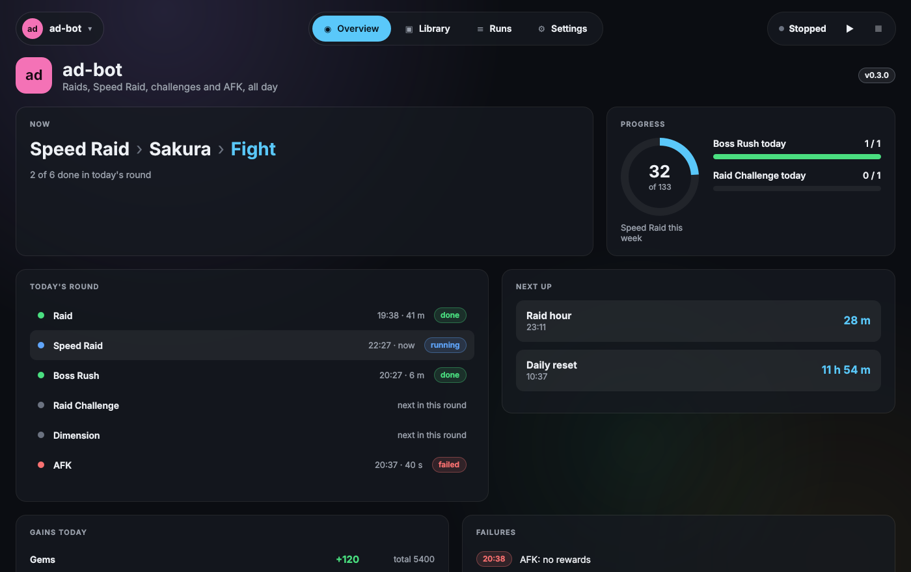

# darbit Studio

darbit Studio is a window onto darbit's service: pick a bot, run, pause and stop it, and see what it's doing. It's built with Qt (PySide6 and QML) and needs the `studio` extra:

```bash
pip install "darbit[studio]"     # or, in a checkout: uv sync --extra studio
darbit app
```



- **The bot picker** (top left) lists every bot the service knows; the Studio opens on the one shown last.
- **Overview** (Ctrl+1): what the bot is doing now, its progress, today's round, what's next, gains and failures, from its run report.
- **Library** (Ctrl+2): its pictures, points and areas by group, with their last match score; Risky and Missing filter them.
- **Runs** (Ctrl+3): a day at a time: how long each mode ran, what was gained, what went wrong, from the run history.
- **Settings** (Ctrl+4): the bot's `settings.toml` as a form; changes are kept until Save.
- **Capture** (the Library's Capture button): the Studio steps aside, the screen is frozen, and it opens full screen.
  Click something to box it (again for bigger, right-click for smaller) or drag a box; the handles and the arrow keys
  change it (Shift: 10 px, Ctrl: its size). Image, Region or Point; **T** tests it (every match, with its score);
  name it and press **Enter** to save; **Esc** closes. With a setup guide, the next picture to take is shown.
- **The run controls** (top right): Play, Pause or Go on, and Stop, with how long it has run.

Closing the Studio stops nothing: bots run in the service, which keeps going (see [the service](service.md)). The tray icon opens it again.

The pages follow the mockups in `docs/ui/` and the tokens in [the design system](../style/ui/design-system.md); `darbit.studio.app.shot()` draws any page into a PNG with no screen, which the tests use for every page and theme.

Highlight, the recorder and the action editor come next (rebuild plan, milestone 4).
