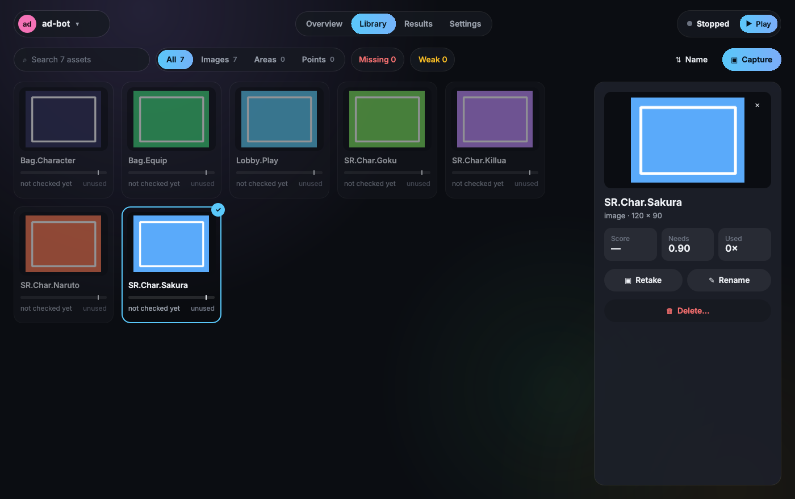
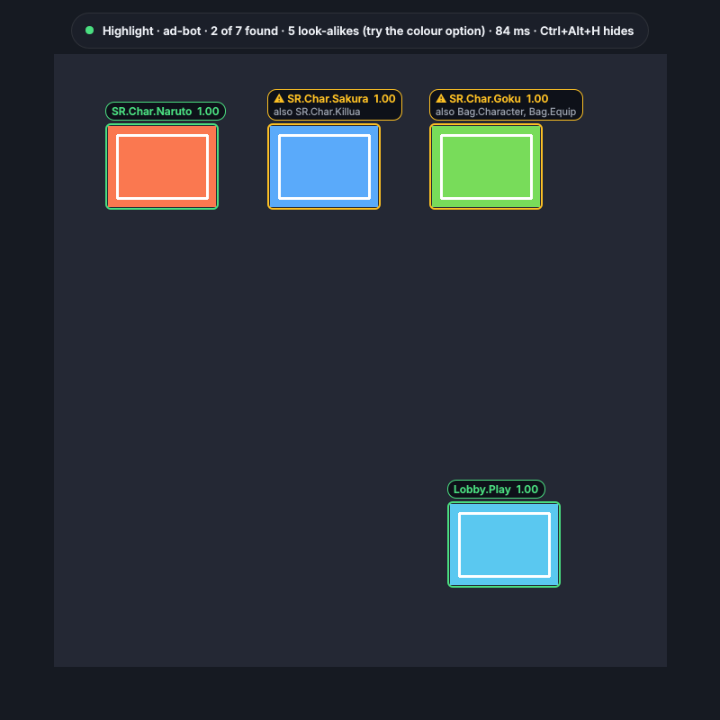
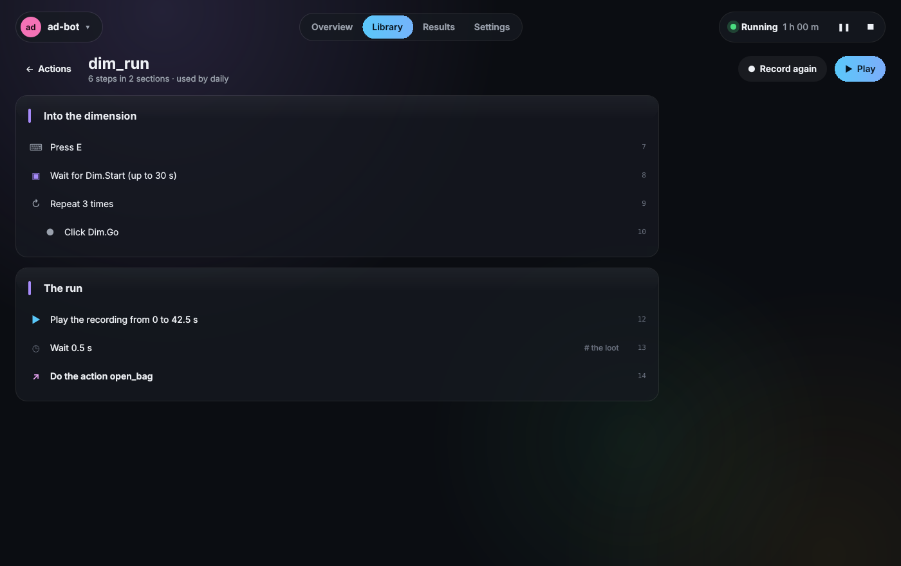

# darbit Studio

darbit Studio is a window onto darbit's service: pick a bot, run, pause and stop it, and see what it's doing. It's built with Qt (PySide6 and QML) and needs the `studio` extra:

```bash
pip install "darbit[studio]"     # or, in a checkout: uv sync --extra studio
darbit app
darbit app --shortcut            # once: darbit Studio in the Start menu and on the desktop
```

The shortcut opens the Studio with the Python it was made from, without a console window. The Studio has darbit's icon in the taskbar, its own button rather than Python's.


- **Bots:** the bot menu at the top left lists every bot, with **New bot** (from darbit's template, from a git link, or a
  folder you have) and **darbit settings**. darbit settings can put the bots in a sidebar instead, which folds to their
  squares on a narrow window. The Studio opens on the bot shown last.
- **Overview** (Ctrl+1): what the bot is doing now and today's round as a bar, then a line for anything that needs you
  (images still to take, the last problem), the round, progress, what's next and gains.
- **Library** (Ctrl+2): the bot's actions first, then every image, region and location, with an image's last score
  against the similarity it needs. Search (Ctrl+F), filter by kind (Images, Regions, Locations, Actions), Missing or
  Weak, sort by name, weakest or most used, and group by name or kind if you like. Click one for the inspector: its
  numbers and last scores (an image also says its region and location, the defaults included: the whole screen and
  its centre), **Retake**, **Rename** (every line of code naming it changes too), **Delete**, **Highlight on screen**
  for an image, and where it's used; an action has **Play**, **Open**, **Record again** and **Rename**.

  
- **Kinds of target.** Each target's settings file names its kind: an **image** (searched in its region, the whole
  screen without one, and clicked at its location, its centre unless moved), a **region**, or a **location**.
  Capture writes it; `darbit kinds BOT` writes it into files from before.
- **Capture** (the Library's Capture button, or Ctrl+Alt+C with the game in front): the Studio steps aside, the screen
  is frozen, and it opens full screen. A target is an image, the region it's searched in and the location to click,
  made together. Pick what you're making in the pill (**Image**, **Region**, **Location**, or **1**, **2**, **3**,
  **Tab**): a click boxes the image or region around it (again for bigger, right-click for smaller), a drag draws
  one, and with Location a click sets it. What's picked is what the handles, the arrow keys (Shift: 10 px, Ctrl: its
  size), drag-to-move and **Delete** change; a ✓ marks each kind the target has. Click a readout to type exact
  numbers; **Ctrl+Z** and **Ctrl+Y** undo and redo. The pill slides out of sight a few seconds after the mouse leaves
  it: move the mouse to the top edge to bring it back. A retake keeps the target's region and location; hold **C** to
  see the saved image over the new one. A magnifier follows the mouse with the shot's own pixels (8×; Ctrl+wheel from
  2× to 24×), the target's parts and the place and colour of the pixel under it; **Z** pins it. **T** tests the image
  in its region: a line sweeps it, then it says whether the image was found once, more than once or not at all, and
  how many look-alikes score under the line, with each match's score and a slider for the similarity it needs.
  **Enter** saves; **Esc** removes what's picked, then closes. With a setup guide, the next one to take is shown.
- **Run pill** (darbit settings, on by default): Play hides the Studio, and a pill at the top of the screen shows the
  bot, where it is and for how long, with Pause, Stop and ⤢ to open the Studio. A few seconds after the mouse leaves
  it, it slides up and leaves a sliver; move the mouse to that edge to bring it back (the bot's own moves don't). The
  bot never sees it in its screenshots. The Studio comes back when the bot stops or fails, or from the tray.
- **Ghost cursor** (darbit settings, on by default): a ripple where a running bot clicks and keycaps for the keys it
  presses, over the game, for a moment each. Clicks go through it, and it shows only while there's something to show.
- **Highlight** (Highlight on screen in the Library's side panel for an image, or Ctrl+Alt+H with the game in front
  for the last one chosen): where that image is found on screen right now. The Studio steps aside and the image
  gets its box and score over the game, a couple of
  times a second; one just under what it needs gets a faint one. Images found on the same spot are marked ⚠ with
  the others' names: the bot can't tell them apart there, which the `colour` option often fixes. Clicks go to the
  game. Ctrl+Alt+H again hides it.

  
- **Record** (the Library's Record button): name the action, and the Studio steps aside. A pill at the top of the
  screen shows the time and the steps caught; every key, click, wheel notch and mouse move goes in, on one clock, until
  **Done**. **Pause** (Ctrl+Alt+P) to add a check: wait for an image or until it's gone (Capture opens on that
  moment to take it), or a wait. ⚑ (Ctrl+Alt+K) is a checkpoint: what came before becomes its own action. ≡ shows the
  steps; ✕ throws the recording away. Clicks on the pill aren't recorded.
- **Actions** (the Library's Actions): each with its steps and what calls it; **Play**, **Open**, **Record again**,
  **Rename** (every call changes too) and **Delete**.
- **An action, open** (Open, or double-click its card): its sections as cards and its steps read like what they do:
  keys, waits, images to wait for, clicks, loops and ifs with their steps indented, the recording's span, calls to
  other actions. **Play** walks through them, the step playing glowing. A section's name, a wait's seconds (hover it)
  and the order of steps (↑ ↓) can be changed and steps removed (✕); the save bar writes the action's file
  (Ctrl+S). It's still plain Python in `actions/`, so it opens in any editor too.

  
- **Results** (Ctrl+3): the bot's days; the chosen one in a sentence, its problems, what it got (today, the week, the
  total) and a timeline of its modes, from the run history.
- **Settings** (Ctrl+4): the bot's `settings.toml` as a form, by section; a changed value gets a dot and a save bar
  slides up (Ctrl+S saves).
- **The run control** (top right): Play (F5); while running, its time with Pause and Stop.
- **darbit settings** (Ctrl+,): the theme, the bot sidebar, and smooth effects (off for a slower PC). A `theme.toml` in
  darbit's settings folder lays tokens over the theme (`base = "glass-dark"`, `accent = "#ff7ab6"`).

Closing the Studio stops nothing: bots run in the service, which keeps going (see [the service](service.md)). Closing the window keeps darbit in the tray; the tray icon opens it again, and its menu quits. It opens where it was left, at the same size. Starting `darbit app` again brings the open Studio forward instead of opening a second one.

The pages follow the mockups in `docs/ui/` and the tokens in [the design system](../style/ui/design-system.md); `darbit.studio.app.shot()` draws any page into a PNG with no screen, which the tests use for every page and theme.

Highlight, the recorder and the action editor come next (rebuild plan, milestone 4).
